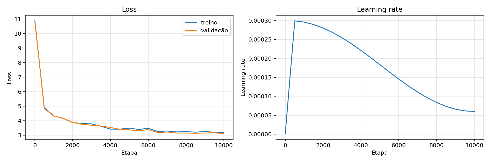

# LLM Zero

Mini modelo de linguagem causal em português, implementado do zero com
PyTorch para estudar o funcionamento de um modelo no estilo GPT.

> **Status:** projeto educacional em evolução. O modelo continua textos, mas
> ainda não é um chatbot nem segue instruções.

## Visão geral

```text
dataset → limpeza e tokenização → Transformer causal → treino → geração
```

O projeto inclui:

- preparação de dados em streaming;
- tokenizer GPT-2 via `tiktoken`;
- Transformer causal com atenção, MLP, LayerNorm e embeddings posicionais;
- treinamento com AdamW, mixed precision e gradient accumulation;
- checkpoints, métricas e geração por prompt.

## Resultados atuais

Os experimentos abaixo usam a Wikipédia em português, a mesma arquitetura e a
mesma seed.

| Experimento | Etapas | Batch | Parâmetros | Melhor val loss | Perplexidade |
|---|---:|---:|---:|---:|---:|
| v1 | 10.000 | 4 × 4 | 30.044.544 | 3,1130 | 22,49 |
| v2 | 30.000 | 8 × 4 | 30.044.544 | **2,5508** | **12,82** |

<details>
<summary>Gráficos e detalhes dos resultados</summary>

### Gráficos




Na v2, o melhor resultado ocorreu na etapa `28.000`. Os relatórios completos
ficam nas pastas de cada experimento:

```text
benchmark.json
metrics.csv
run.json
training_metrics.png
```

</details>

## Início rápido

### Instalação

```powershell
python -m pip install torch numpy tiktoken datasets tqdm matplotlib
```

Com o ambiente virtual deste projeto:

```powershell
.\venv\Scripts\python.exe -m pip install torch numpy tiktoken datasets tqdm matplotlib
```

### Preparar a Wikipédia

```powershell
.\venv\Scripts\python.exe scripts\prepare_wiki.py --artigos 100000 --forcar
```

Os arquivos serão criados em `data/wiki_pt/train.bin` e
`data/wiki_pt/val.bin`.

### Treinar

```powershell
.\venv\Scripts\python.exe train.py
```

### Gerar texto

```powershell
.\venv\Scripts\python.exe generate.py `
    --out-dir experiments/wiki-100k-v2 `
    --prompt "A história do Brasil" `
    --max-new-tokens 200
```

## Estrutura

```text
llm-zero/
├── config.py, model.py, train.py, generate.py
├── scripts/
│   ├── benchmark.py
│   ├── prepare_wiki.py
│   └── prepare_corpus_ptbr.py
├── data/                       # datasets locais
├── experiments/                # métricas e checkpoints
├── docs/plano_llm_zero.md
└── README.md
```

<details>
<summary>Configuração do modelo</summary>

As configurações ficam em [config.py](config.py):

```text
vocab_size: 50.257
block_size: 256
n_layer: 6
n_head: 6
n_embd: 384
dropout: 0,1
```

O dispositivo padrão é CUDA. Para usar CPU, altere `device` para `"cpu"`.

</details>

<details>
<summary>Testes curtos e retomada</summary>

Os valores padrão vêm de `TrainConfig`. Para testar sem editar o arquivo:

```powershell
.\venv\Scripts\python.exe train.py `
    --max-iters 20 `
    --eval-interval 10 `
    --eval-iters 5 `
    --out-dir experiments/teste
```

Para retomar um treinamento interrompido:

```powershell
.\venv\Scripts\python.exe train.py `
    --out-dir experiments/corpus-ptbr-100k-v1 `
    --resume
```

O treinamento salva:

```text
best.pt       # melhor checkpoint pela val loss
last.pt       # último estado salvo
metrics.csv   # losses, perplexidade, learning rate e tempo
run.json      # configuração e resumo da execução
```

</details>

<details>
<summary>Novo corpus PT-BR</summary>

O preparador [prepare_corpus_ptbr.py](scripts/prepare_corpus_ptbr.py) usa
streaming, limpeza, deduplicação e separação por documento:

```powershell
.\venv\Scripts\python.exe scripts\prepare_corpus_ptbr.py `
    --documentos 100000 `
    --out-dir data\corpus_ptbr_100k
```

Para manter a comparação justa, o novo corpus usa inicialmente a mesma
arquitetura e o mesmo tokenizer dos experimentos da Wikipédia.

</details>

<details>
<summary>Benchmark e comparação</summary>

Depois do treinamento:

```powershell
.\venv\Scripts\python.exe scripts\benchmark.py `
    --out-dir experiments/wiki-100k-v2
```

Para comparar modelos, mantenha os mesmos prompts, `temperature`, `top_k` e
`max_new_tokens`. Exemplos:

```text
A história do Brasil
Os jogadores brasileiros que participaram da Copa do Mundo
A população brasileira
A cidade de São Paulo
O desenvolvimento da tecnologia no Brasil
```

Avalie fluidez, coerência, relevância, gramática e repetição. Perplexidade é
útil para comparação quantitativa, mas não garante factualidade ou qualidade
de conversa.

</details>

<details>
<summary>Execução no Kaggle</summary>

Depois de clonar o repositório e ativar uma GPU:

```python
!pip install -q tiktoken matplotlib
!python -u train.py --max-iters 30000 --eval-interval 500 --eval-iters 50 --out-dir experiments/corpus-ptbr-100k-v1
!python scripts/benchmark.py --out-dir experiments/corpus-ptbr-100k-v1
```

</details>

## Limitações e próximos passos

- o tokenizer atual não é específico para português;
- o corpus é enciclopédico e não representa conversas;
- o modelo pode repetir ou combinar fatos incorretamente;
- ainda faltam avaliação automática e testes mais abrangentes.

Próximas etapas: comparar o novo corpus, treinar um tokenizer BPE próprio para
português e avaliar mudanças de arquitetura.

## Créditos

O fluxo é inspirado no [nanoGPT](https://github.com/karpathy/nanoGPT), de
Andrej Karpathy. O projeto utiliza [PyTorch](https://pytorch.org/),
[tiktoken](https://github.com/openai/tiktoken) e
[Hugging Face Datasets](https://huggingface.co/docs/datasets).
